# 🛡️ WEEK 2 SECURITY ASSESSMENT REPORT

### 🔍 Reconnaissance and Network Discovery

**W2-PM-FINAL | NETWORKWALKS CYBERSECURITY & ETHICAL HACKING INTERNSHIP**

| Item | Detail |
| --- | --- |
| **👤 Prepared by** | **Obioma ThankGod Chimaijem** |
| **🎓 Internship batch** | 📝`B084-Networkwalks` |
| **📅 Report date** | 10 November 2026 |
| **✅ Modules done** | W2-PM1 (footprinting with Kali tools) W2-PM4 (theHarvester) W2-PM5 (Zenmap network scan) |
| **🎯 Targets** | 1. networkwalks.com (the lab's assigned target) 2. microsoft.com (public-source OSINT only, as set in the lab) 3. My own home Wi-Fi network |
| **🔐 Authorisation** | The websites were lab-assigned targets, and the network scan was run only on a network I own. theHarvester read public sources and never contacted microsoft.com directly. |
| **🧭 Stage reached** | **Stage 1:** information gathering **Stage 2:** scanning and host discovery **Later stages:** not started |

---

# ⚖️ 1. Liability Disclaimer

Everything in this report was done inside a supervised learning lab. I only worked on targets that the lab assigned to me, plus a network that belongs to me. The commands and findings are shared for study purposes. They should never be used against a system you have no permission to test. In most countries, entering someone else's system without consent is a crime whether or not any damage is done, and the consequences can be serious. I take responsibility for my own actions.

---

# 📖 2. Introduction

This is my Week 2 write-up for the Networkwalks internship. I worked through three practical modules:

- **W2-PM1:** learning what the internet can reveal about `networkwalks.com`, using six Kali Linux tools
- **W2-PM4:** collecting emails, sub-domains and hosts with **theHarvester**
- **W2-PM5:** finding the live devices on my own Wi-Fi network with **Zenmap**

The first two modules are about what an outsider can learn without touching a target. The third is about discovering what is alive on a network I control. Together they follow the path a real assessment takes, from public information to a map of reachable hosts.

I ran the footprinting commands from Kali Linux inside VirtualBox, and did the network scan from Windows. For each activity I note the command, what came back, where the screenshot is, and why a defender should care.

---

# 🧰 3. Tools Used

| Tool | What I used it for |
| --- | --- |
| 🐧 Kali Linux (VirtualBox) | Main environment for the footprinting commands |
| 🌐 WHOIS | Shows who registered a domain, when, and which name servers it uses |
| 🔎 whatweb | Tells me what software a website appears to run (server, CMS, plugins) |
| 📡 nslookup | Asks DNS which IP address a domain name points to |
| 📨 curl -I | Fetches only the headers a web server sends back |
| 🧱 wafw00f | Probes a site to see whether a web application firewall sits in front of it |
| 🗂️ dnsrecon | Pulls a domain's DNS records (name servers, mail, TXT, services) |
| 🌾 theHarvester | Collects emails, sub-domains and hosts from public search sources |
| 🗺️ Zenmap | Graphical front end for Nmap, used to ping-sweep my subnet |
| 💻 `Windows CMD` | Shows my PC's IP address, subnet, gateway and MAC addresses |
| 📸 ShareX | Screenshots for the evidence section |

---

# 🧪 4. Activities Performed

## 🔍 4.1 W2-PM1: Footprinting & Reconnaissance (networkwalks.com)

I performed reconnaissance against `networkwalks.com` using six Kali Linux tools. Each tool revealed a different part of the target's profile.

### 4.1.1 🌐 WHOIS: domain registration

**Command:** `whois networkwalks.com`

- **Registrar:** GoDaddy.com, LLC
- **Created:** 2019-11-06, **last updated:** 2025-11-12, **expires:** 2027-11-06
- **Name servers:** `NS6135.HOSTGATOR.COM` and `NS6136.HOSTGATOR.COM`, so the site is hosted at HostGator
- **DNSSEC:** unsigned
- **Domain status locks:** clientDeleteProhibited, clientRenewProhibited, clientTransferProhibited and clientUpdateProhibited (these protect against unauthorised transfer or changes)
- **Registrant details:** not shown (privacy-protected)

🎯 *Attacker view:* the name servers instantly reveal the hosting provider, and the registration/abuse details help with planning and social engineering.

### 4.1.2 🔎 WhatWeb: web technologies

**Command:** `whatweb networkwalks.com`

- **Web server:** Apache
- **CMS:** WordPress 7.1.4 with **WordPress Download Manager 3.3.76** (from the MetaGenerator output)
- **Front-end:** jQuery 3.7.1, Bootstrap, HTML5, Google Tag Manager
- **IP address:** `192.232.216.135` (United States)
- **Redirect:** `http://networkwalks.com` returns `301 Moved Permanently` to `https://`
- **Other details:** HttpOnly cookie `__wpdm_client`, contact email `info@networkwalks.com`, page title "Networkwalks Academy"

🎯 *Attacker view:* the CMS, plugin and version information tells an attacker which known weaknesses to look for.

### 4.1.3 📡 Nslookup: DNS resolution

**Command:** `nslookup networkwalks.com`

- **DNS server used:** `8.8.8.8` (Google), non-authoritative answer
- **Result:** `networkwalks.com` resolves to **`192.232.216.135`**, which matches the IP found by WhatWeb

🎯 *Attacker view:* the IP address gives the network location of the web service and is the starting point for scanning.

### 4.1.4 📨 Curl: HTTP response headers

**Command:** `curl -I https://networkwalks.com`

- **Status:** `HTTP/2 200`, **server:** Apache
- **Caching headers:** `x-nginx-cache: WordPress`, `x-endurance-cache-level: 0`
- **Cookie:** `__wpdm_client` set with the `Secure` and `HttpOnly` flags (good practice)
- **Present headers:** `permissions-policy`, `referrer-policy: no-referrer-when-downgrade`
- **Exposed endpoint:** `Link` headers reveal the WordPress REST API at `/wp-json/`
- **Missing security headers:** `Strict-Transport-Security` (HSTS), `X-Frame-Options`, `X-Content-Type-Options`, `Content-Security-Policy`

🎯 *Attacker view:* the missing headers show where browser-side protection is weak, and the `Link` and `Server` headers confirm the technology stack.

### 4.1.5 🧱 Wafw00f: Web Application Firewall detection

**Command:** `wafw00f https://networkwalks.com`

- **Result:** the site is behind **ModSecurity (SpiderLabs)** WAF, detected in 2 requests (wafw00f v2.4.2)
- My first attempt timed out because of a slow connection. The second attempt succeeded.

🎯 *Attacker view:* knowing the WAF lets an attacker choose evasion techniques or look for ways around it.

### 4.1.6 🗂️ DNSRecon: DNS enumeration

**Command:** `dnsrecon -d networkwalks.com`

- **SOA / NS:** `ns6135.hostgator.com` (50.87.144.87) and `ns6136.hostgator.com` (192.232.216.131)
- **A record:** `networkwalks.com` → `192.232.216.135`
- **MX record:** `mail.networkwalks.com` → `192.232.216.135` (web and mail share the same server)
- **SPF (TXT):** `v=spf1 +a +mx +ip4:50.87.144.87 +include:websitewelcome.com ~all` (uses a **softfail**, `~all`)
- **TXT:** a Google site-verification record
- **SRV:** 8 `_autodiscover._tcp` records pointing to `cpanelemaildiscovery.cpanel.net`, which shows the host uses cPanel
- **DNSSEC:** no answer to the DNSSEC query, which matches the unsigned status in WHOIS
- **BIND version:** both name servers disclose version `9.16.23-RH`

🎯 *Attacker view:* the records map the infrastructure, the exposed software version helps targeting, and the softfail SPF policy makes spoofed emails easier.

---

## 🌾 4.2 W2-PM4: theHarvester (microsoft.com)

theHarvester (v4.10.1) collects emails, sub-domains and hosts from **public sources**, so the target is never contacted directly.

### 4.2.1 Task 1: Baidu source, limit 1000

**Command:** `theHarvester -d microsoft.com -l 1000 -b baidu`

📝 `[ADD YOUR TASK 1 RESULT HERE: emails / hosts / IPs found, or "no results returned" if Baidu returned nothing]`

### 4.2.2 Task 2: all sources, limit 50

**Command:** `theHarvester -d microsoft.com -l 50 -b all`

- The run returned a large list of `microsoft.com` **sub-domains**, some with IP addresses (for example `131.107.86.5`, `131.107.86.17`, `134.33.7.97` and an IPv6 address).
- Many names point to **staging, QA, test and pre-production** environments (for example `wwwqa`, `wwwbeta` and `staging` hosts).
- Sources that need an API key (SecurityScorecard, BuiltWith and others) were skipped with "Missing API key" warnings. This is expected without keys.
- Some sources returned no emails, people, IPs or hosts. Results differ between sources and between runs.
- The saved output file (`task2.txt`) has 184 lines.

🎯 *Attacker view:* every harvested email is a possible phishing target and every sub-domain is another door into the organisation that a defender may have forgotten about.

---

## 🗺️ 4.3 W2-PM5: Network Scanning with Zenmap (my own network)

I used Zenmap on my own Wi-Fi network. All seven practical tasks were completed:

| Task | What I did | Result |
| --- | --- | --- |
| 1️⃣ | Downloaded and installed Zenmap from the official site (nmap.org, Nmap 7.993 installer) | ✅ Zenmap installed and running |
| 2️⃣ | Found my local IP and LAN subnet with `ipconfig` | IP `192.168.61.164`, mask `255.255.255.0`, gateway `192.168.61.230`, subnet **`192.168.61.0/24`** |
| 3️⃣ | Ran a **Ping scan** on the subnet (`nmap -sn 192.168.61.0/24`) | 2 live hosts found |
| 4️⃣ | Counted the live hosts | **2 hosts** (including my PC) |
| 5️⃣ | Listed the IP addresses | `192.168.61.230` and `192.168.61.164` |
| 6️⃣ | Listed the MAC addresses | `16:7F:6E:7B:2B:0B` (gateway, vendor "Unknown") and `9C-2A-70-7C-70-82` (my PC, from `ipconfig /all`) |
| 7️⃣ | Saved the Topology as a PDF on my Desktop | ✅ `zenmap_topology.pdf` (included below) |

**Scan summary:** "256 IP addresses (2 hosts up) scanned in 10.12 seconds."

**Notes:**
- Nmap does not list a MAC address for the machine it runs on, so my own PC's MAC came from `ipconfig /all` (Wireless LAN adapter Wi-Fi 2, Broadcom 802.11n).
- The gateway's MAC has no known vendor, which is common when a router or phone hotspot uses a randomised (locally administered) MAC address.
- My result has fewer hosts than the sample because my network only had two devices on it.

📎 **Topology PDF:** [`zenmap_topology.pdf`](screenshots/zenmap_topology.pdf)

---

## 🧯 4.4 Problems I Ran Into

| Problem | Cause | What fixed it |
| --- | --- | --- |
| `nslookup` and `wafw00f` timed out | Unstable internet connection | Repeated the commands until they completed |
| `dnsrecon.txt` came out empty | dnsrecon writes to the error stream | Re-ran with `> dnsrecon.txt 2>&1` |
| theHarvester rejected my command | I typed the digit `1` instead of a lowercase `l` in `-l` | Retyped it correctly |
| Nmap installer failed its integrity check | The download was incomplete | Deleted it and downloaded the full file from nmap.org |
| Windows SmartScreen blocked the installer | The file is not widely recognised | Confirmed it came from nmap.org, then chose "Run anyway" |

---

# ⚠️ 5. Risk Analysis

The table below lists what stood out to me, with a rough rating of how much each item could help an attacker.

| **#** | **Risk / Finding** | **Evidence / Observation** | **Potential Impact** | **Risk Level** |
| --- | --- | --- | --- | --- |
| 1 | CMS and plugin versions visible | WhatWeb listed WordPress and the Download Manager plugin with versions | Known issues for those versions can be looked up quickly | 🟡 **Medium** |
| 2 | Key security headers absent | Curl showed no HSTS, X-Frame-Options, X-Content-Type-Options or CSP | Less protection in the browser against clickjacking, MIME sniffing and script injection | 🟡 **Medium** |
| 3 | SPF set to softfail | DNSRecon returned a policy ending in `~all` | Forged emails from the domain may still be accepted | 🟡 **Medium** |
| 4 | Many sub-domains public | theHarvester listed numerous sub-domains, including staging and QA names | A bigger attack surface and a view of internal naming | 🟡 **Medium** |
| 5 | WordPress REST API advertised | `Link` headers point to `/wp-json/` | Makes it easier to fingerprint and enumerate the site | 🟢 **Low** |
| 6 | DNSSEC not enabled | WHOIS says unsigned and DNSRecon got no DNSSEC answer | DNS answers are not cryptographically signed | 🟢 **Low** |
| 7 | DNS software version shown | Name servers reported BIND `9.16.23-RH` | Helps target flaws in that specific version | 🟢 **Low** |
| 8 | Hosting setup identifiable | HostGator, cPanel and the server IP appear in WHOIS and DNS data | Reveals where and how the service is hosted | 🟢 **Low** |
| 9 | Firewall product identifiable | Wafw00f named ModSecurity | Tells an attacker what to work around (though having a WAF is a good control) | 🟢 **Low** |
| 10 | Local devices easy to discover | A Ping scan listed both devices with IP and MAC details | Any device on a network can be found this way, which also helps defenders spot strangers | 🟢 **Low** |

**Rating key:** 🔴 Critical &nbsp; 🟡 Medium &nbsp; 🟢 Low

> ℹ️ These are things I noticed, **not proven weaknesses**. I did not try to exploit anything. A version number, IP address or DNS record only tells you where to look next. Confirming a real flaw would take authorised, deeper testing.

---

# ✅ 6. Recommendations

Based on the observations from these activities, I recommend the following security improvements:

1. 🔎 **Review publicly exposed technology information**
   Regularly review what information about the web server, CMS and plugins is publicly visible.

2. 🔄 **Keep software updated**
   Update WordPress, plugins and other components, and check them against current security advisories.

3. 🧾 **Add missing HTTP security headers**
   Enable HSTS, X-Frame-Options, X-Content-Type-Options and a Content-Security-Policy, and review which headers expose unnecessary technical detail.

4. ✉️ **Strengthen the SPF policy**
   Move from softfail (`~all`) to a hard fail (`-all`) once all legitimate senders are covered, and consider adding DKIM and DMARC.

5. 🔐 **Enable DNSSEC**
   Sign the domain so DNS answers cannot be tampered with.

6. 🗂️ **Review DNS records and hide version banners**
   Check DNS records periodically, and hide the BIND version on name servers.

7. 🧱 **Properly configure and monitor the WAF**
   Keep ModSecurity enabled and tuned, since it already blocks naive attacks.

8. 🌐 **Control sub-domain exposure**
   Review public sub-domains, remove unused ones, and keep staging/test systems off the public internet or behind authentication.

9. 📡 **Perform regular internal network discovery**
   Periodically scan your own network to identify active devices, and investigate any unknown device.

10. 📝 **Maintain network documentation**
    Keep topology and device information documented and up to date.

11. ⚖️ **Perform security testing with authorisation**
    Reconnaissance and scanning should only be performed against systems and networks where appropriate authorisation has been provided.

---

# 🏁 7. Conclusion

Week 2 showed me how much can be learned about a system before any attack is attempted. With six simple Kali tools I built a picture of `networkwalks.com`: who registered it, where it is hosted, what software it runs, which firewall guards it, and how its DNS and email are set up. theHarvester added another angle by showing how much a public source can reveal about a large organisation's sub-domains, even when some sources need API keys I did not have.

With Zenmap, I mapped my own Wi-Fi network, found the live devices, and saved the topology. Doing this on a small home network made it clear how easy host discovery is, and why defenders should run the same scan on themselves.

I also learned that results are only useful when documented clearly: the command, the output, the meaning, the risk and the fix. And I was reminded that tools like these should only be pointed at systems you are allowed to test. Along the way I fixed practical problems such as timeouts, an empty output file, a mistyped option and a broken installer, which taught me to read error messages carefully rather than guess.

---

# 📸 8. Evidence

*All screenshots are stored in the `screenshots/` folder.*

### 🔍 W2-PM1: Footprinting

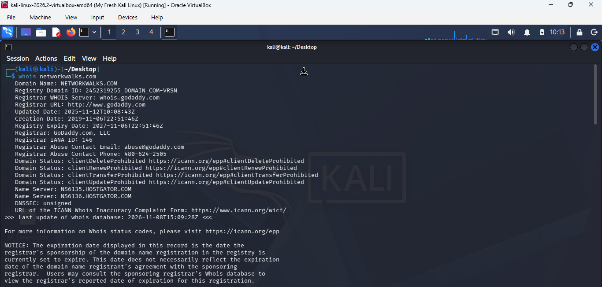

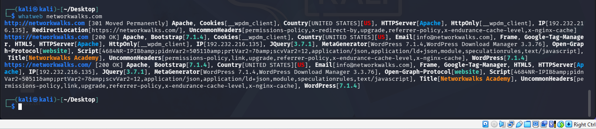

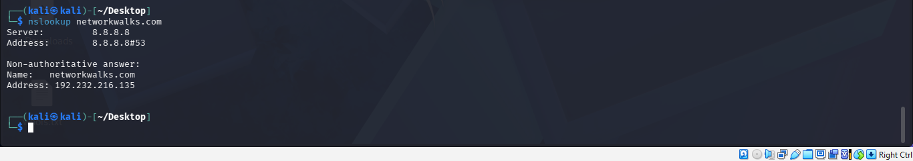

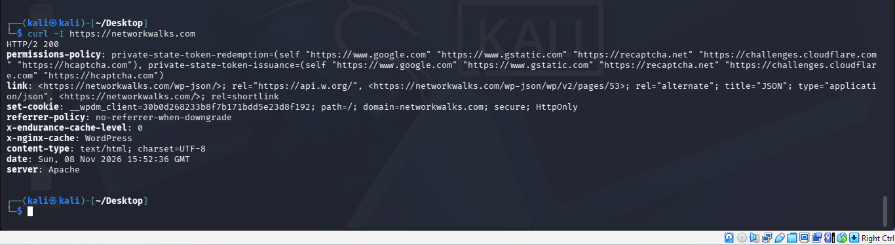

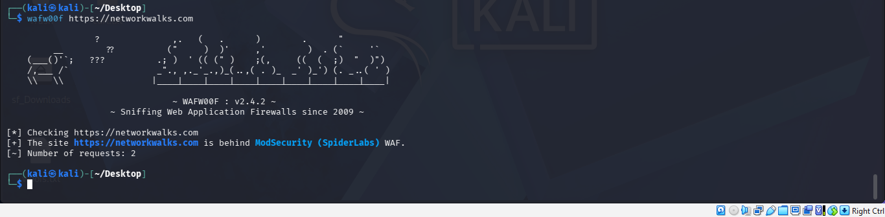

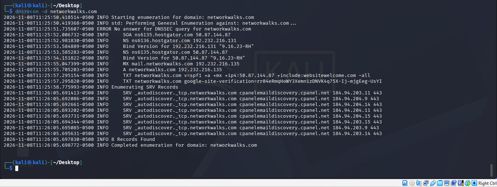

### 🌾 W2-PM4: theHarvester

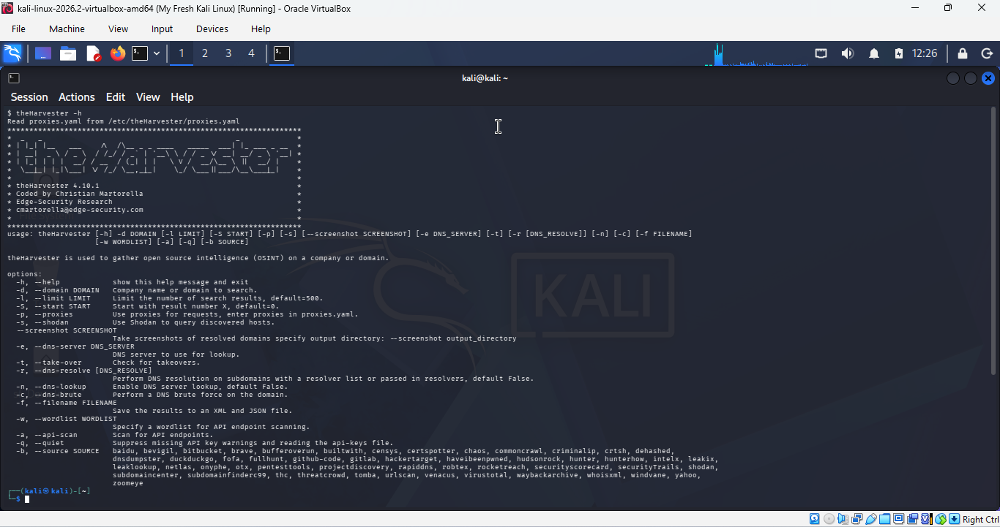

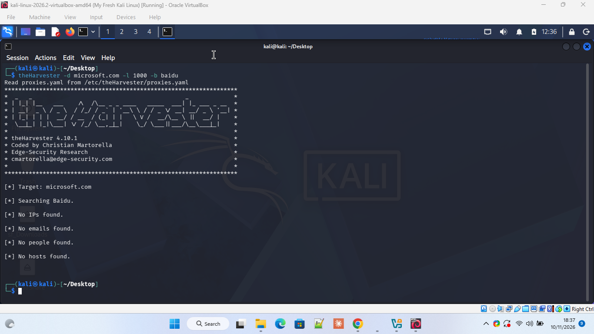

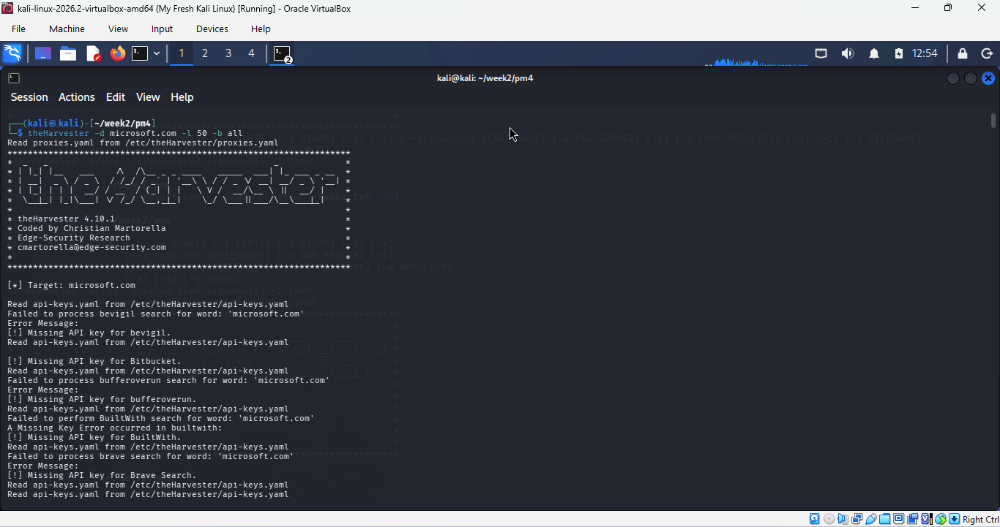

### 🗺️ W2-PM5: Zenmap

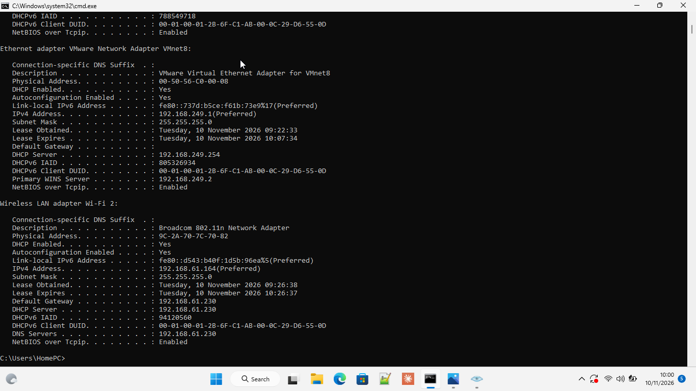

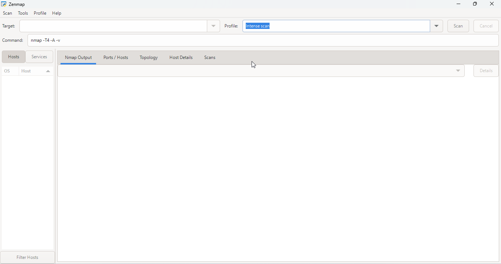

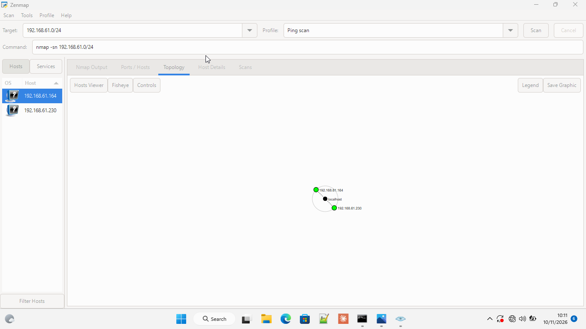

📎 Topology PDF: [`zenmap_topology.pdf`](screenshots/zenmap_topology.pdf)

---

-End-
